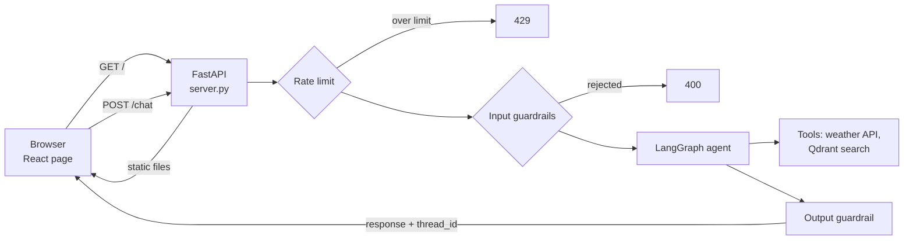

# Weather Agent MLOps

A production-oriented LangGraph agent that answers weather and air-quality questions,
combining live weather data with a RAG pipeline over historical air-quality records.
Built for deployment on GCP Cloud Run with a full CI/CD and evaluation layer.

## Architecture

The system is split into two independently deployable units:

- **Ingestion job** (Cloud Run Job, scheduled) — fetches raw data and indexes it into Qdrant.
- **Agent service** (Cloud Run Service, always-on) — serves the LangGraph agent over an HTTP API.

Both share common config/secret-loading and tool code.

```
Client → server.py (FastAPI) → guardrails → LangGraph agent → tools (weather API, vector search) → response
                                                                 ↑
                                              Qdrant ← index_qdrant.py ← fetch_raw_data.py (ingestion job)
```

## Stack

- **Orchestration:** LangGraph (`src/agent/`)
- **LLM:** Gemini via Vertex AI
- **Vector store / RAG:** Qdrant, over historical air-quality data
- **Live data:** OpenWeatherMap API (`src/tools/weather_api.py`)
- **Deployment:** GCP Cloud Run — agent as a Service, ingestion as a Job
- **CI/CD:** GitHub Actions

## Project structure

```
├── .github/workflows/       # CI/CD: ingestion job, agent service, PR checks
├── config/                  # Per-environment config (dev/prod)
├── src/
│   ├── common/               # Shared config + secret loading
│   ├── data/                 # Ingestion: fetch raw data, index into Qdrant
│   ├── tools/                 # Agent tools: weather API, vector search
│   ├── agent/                 # LangGraph state, nodes, graph
│   └── api/                   # HTTP layer: guardrails, rate limit, static front end
├── frontend/                 # React + TypeScript chat page (Vite)
├── eval/                     # Golden queries, eval runner, LLM-as-judge
├── tests/                    # Unit tests (no live LLM calls)
├── deploy/                   # Dockerfiles + Cloud Build config
├── main.py                   # Local CLI entrypoint
├── server.py                 # FastAPI production entrypoint
└── Makefile                  # make test / make eval / make deploy-agent
```

## Conventions

- Guardrails (input/output checks) live in `src/api/guardrails.py`, **not** inside LangGraph nodes.
- Secrets are loaded via `src/common/config.py` — never hardcoded or committed.
- New files should follow the folder structure documented here.

## Getting started

```bash
# install dependencies
pip install -r requirements.txt -r requirements-dev.txt

# run the agent locally via CLI
python main.py

# run the API server locally
uvicorn server:app --reload --port 8000

# run unit tests
make test

# run the agent eval suite
make eval
```

## Front end

A small React + TypeScript chat page lives in `frontend/` (built with Vite, no UI library).
It talks only to `POST /chat`, keeps the returned `thread_id` so follow-up questions share
the agent's memory, and shows friendly messages for guardrail rejections (400), rate
limiting (429) and errors (500 / network), never the server's raw error text.

### Run it locally

```bash
# terminal 1: the API on :8000
uvicorn server:app --reload --port 8000

# terminal 2: the Vite dev server on :5173 (proxies /chat and /health to :8000)
cd frontend
npm ci
npm run dev
```

Open http://localhost:5173. Front end tests: `make frontend-test` (or `cd frontend && npm test`).

### How it is built and served

- `npm run build` type-checks and writes static files to `frontend/dist/`.
- `server.py` mounts `frontend/dist` at `/` (`src/api/static.py`) after all API routes,
  so `/chat`, `/health`, `/metrics` and `/docs` keep working. Without a build, the API runs alone.
- `deploy/docker/Dockerfile.agent` is multi-stage: a Node stage builds the front end and the
  Python image copies in only `dist/`. Page and API share one origin and one Cloud Run
  service, so no CORS is needed.
- Cost protection: `/chat` is rate limited per client IP (10 messages/minute, in memory,
  `src/api/rate_limit.py`) before the guardrails run, and Cloud Run is capped at 2 instances.



## Deployment

- `deploy-agent-service.yaml` tests (backend + front end), builds and deploys the agent API and
  front end as a Cloud Run Service on pushes to `main` that touch `src/`, `server.py`,
  `requirements.txt`, `frontend/`, the agent Dockerfile or `.dockerignore`.
- `ci-test.yaml` runs the backend unit tests and the front end tests and build on every pull request.
- The ingestion pipeline is submitted as a Vertex AI Pipeline (`src/pipelines/`).

## Current focus

- Migrating orchestration from plain LangChain to LangGraph.
- Adding the production MLOps layer: Docker, Cloud Run, Secret Manager, CI/CD.
